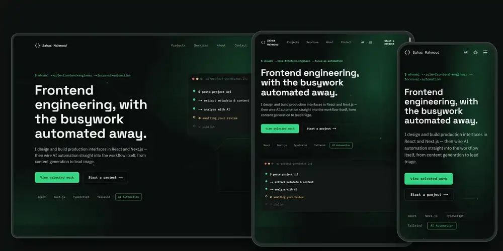

# Portfolio — Sahar Mahmoud

A bilingual (English / Arabic) front-end developer portfolio with a private admin dashboard, built with Next.js and TypeScript. The project is still in progress.

**Live demo:** https://sahar-portfolio.webcraft-labs.workers.dev/



## Features

- Bilingual interface (English and Arabic) with light and dark themes
- Project showcase with filters, search and individual case study pages
- Private admin dashboard to manage projects and case studies, protected by login and route guards
- Contact form with email notifications and automatic replies
- Leads inbox with search, status filters, basic stats and Excel export
- "Ask Sahar's AI" chat assistant
- AI project generator that fills in project details and captures light and dark screenshots
- Rate limiting on the public forms
- Scroll animations built with GSAP

## Tech stack

- **Framework:** Next.js (App Router), React, TypeScript
- **Styling:** Tailwind CSS, next-themes, Lucide icons
- **Data and state:** TanStack Query, Zustand, React Hook Form, Zod
- **Internationalization:** next-intl
- **Database:** PostgreSQL (Neon) with Drizzle ORM
- **Auth:** jose (JWT sessions), bcryptjs
- **Email:** Resend, Nodemailer
- **AI:** Google Gemini API (@google/genai)
- **Deployment:** Cloudflare Workers via OpenNext

## Project structure

```
src/
  app/          Routes and layouts (App Router)
  components/   Shared UI components
  features/     Feature modules (admin, guest)
  db/           Drizzle schema and database client
  i18n/         next-intl configuration
  lib/          Auth, rate limiting, email, AI and project generator helpers
  store/        Zustand stores
messages/       English and Arabic translations
drizzle/        Database migrations
scripts/        Helper scripts (password hashing, checks)
```

## Getting started

```bash
npm install
cp .env.example .env.local   # then fill in your own values
npm run dev
```

The app runs at http://localhost:3000.

## Scripts

| Script | Description |
| --- | --- |
| `npm run dev` | Start the development server |
| `npm run build` | Create a production build |
| `npm run start` | Run the production build |
| `npm run lint` | Run ESLint |
| `npm run format` | Format the code with Prettier |
| `npm run db:generate` / `db:migrate` | Generate and apply database migrations |
| `npm run cf:deploy` | Build with OpenNext and deploy to Cloudflare |

## How this project was built

I built this project with the help of an AI assistant (Claude) as a way to practice working with AI tools and to get more done. I describe what I want each part to do, the assistant helps write it, and then we go through the code together so I understand it and can change it myself. It is a learning exercise in AI-assisted development, not something I handed off completely.

## Author

**Sahar Mahmoud** — Junior Front-End Developer

- LinkedIn: https://www.linkedin.com/in/saharmahmoud-dev/
- Portfolio: https://sahar-portfolio.webcraft-labs.workers.dev/
